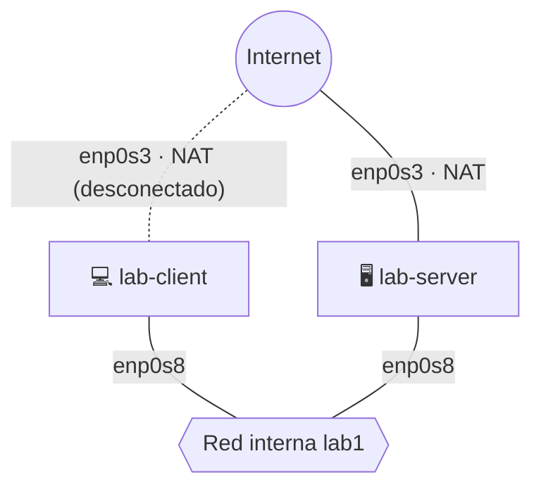

# 0 · Preparar el entorno

**La idea:** vas a armar una "mini red" dentro de tu PC con dos computadoras virtuales (VMs) de Debian 12. Todo lo demás del laboratorio se hace ahí adentro.

| VM | Para qué sirve | Función en cada TP |
|---|---|---|
| `lab-server` | Va a ser el servidor | • En el TP1: funciona como DHCP y DNS<br>• En el TP2: funciona como router<br>• Del TP3 al TP7: funciona como AP Wi-Fi + RADIUS + firewall |
| `lab-client` | Un cliente | • Solo se usa en TP1 y TP2 |

***¿Por qué solo se usa el servidor desde el TP3?** En el TP3 se va a configurar un access point Wi-Fi virtual. Dicho Wi-Fi vive dentro del kernel de lab-server. Los "clientes" de ahí en adelante son *"namespaces"*, osea, mini-computadoras simuladas dentro de la misma VM.*

## Antes de empezar

- VirtualBox instalado (versión 7.1.18 en adelante).

- Crear una carpeta para guardar las VMs

- Unos 12 GB libres en disco y 3 GB de RAM libres en tu computadora.

- En tu **PC host**, necesitás tener instalado:
    - Linux: `qemu-img`, `wget` y `VBoxManage`.
    - Windows: `qemu`, `curl` y `VBoxManage`.

### ¿Cómo instalarlo?

| Sistema | Cómo instalarlo |
|---|---|
| **Linux** (Debian/Ubuntu) | `apt install qemu-utils wget`. `VBoxManage` viene con VirtualBox; verificalo con `VBoxManage --version` |
| **Windows 10/11** | `winget install SoftwareFreedomConservancy.QEMU` (o instalar desde <https://qemu.weilnetz.de/w64/>) y `curl.exe`, que ya viene en Windows normalmente. `VBoxManage` viene con VirtualBox, pero a veces no está en el PATH (arreglo abajo ↓) |

**Solo en Windows:** copiá y pegá los comandos de abajo para agregar qemu y VBoxManage al PATH de Windows (vale solo para esa ventana de PowerShell: hay que repetirlo si la cerrás):

```powershell
# ↓ agrega las carpetas de VirtualBox y de QEMU al PATH de esta ventana
$env:Path += ";C:\Program Files\Oracle\VirtualBox;C:\Program Files\qemu"

# ↓ verifica que los dos programas respondan
qemu-img --version; VBoxManage --version
```

Los dos deben mostrarte el número de versión, algo como `qemu-img version x.x.x` y `x.x.xrxxx`, respectivamente.

Si `qemu-img` no aparece, revisá en qué carpeta quedó instalado QEMU (`dir "C:\Program Files\qemu"`). Si `winget` no encuentra el paquete, usá el instalador de la web.

## Paso 1 · Bajar y convertir la imagen de Debian

🖥️ **En tu PC host**, en la carpeta creada para guardar las VMs, convertir la imagen de Debian 12 de .qcow2 -> a .vdi. Las imágenes ocupan ~3 GB cada una, usá los siguientes comandos:

> *No copiar lo que esté con # al inicio de una línea, esos son comentarios*

**Para Linux:**

```bash
cd /home/<TuUsuario>/<TuNombreDeCarpeta>

# ↓ esto descarga la imagen
wget https://cloud.debian.org/images/cloud/bookworm/latest/debian-12-nocloud-amd64.qcow2

# ↓ esto convierte la imagen de .qcow2 a vdi para que VirtualBox la pueda usar y crea los discos para las VMs
qemu-img convert -O vdi debian-12-nocloud-amd64.qcow2 lab-server.vdi

qemu-img convert -O vdi debian-12-nocloud-amd64.qcow2 lab-client.vdi

# ↓ esto agranda el tamaño de los discos a 10 GB de forma dinámica.
VBoxManage modifymedium disk lab-server.vdi --resize 10240

VBoxManage modifymedium disk lab-client.vdi --resize 10240
```

**Para Windows:**

```powershell
curl.exe -L -O https://cloud.debian.org/images/cloud/bookworm/latest/debian-12-nocloud-amd64.qcow2

qemu-img convert -O vdi debian-12-nocloud-amd64.qcow2 lab-server.vdi

qemu-img convert -O vdi debian-12-nocloud-amd64.qcow2 lab-client.vdi

VBoxManage modifymedium disk lab-server.vdi --resize 10240

VBoxManage modifymedium disk lab-client.vdi --resize 10240
```
*Nota de color: Se usa la imagen debian **nocloud** porque trae el kernel estándar, que incluye `mac80211_hwsim` (el Wi-Fi virtual). La *genericcloud* **no** lo trae. Se hacen dos copias porque cada disco necesita su propio identificador.*

## Paso 2 · Crear las VMs

🖥️ **En tu PC host**, misma terminal y carpeta que en el Paso 1.

> Mismos comandos en Linux y en Windows.

```bash
# ↓ crea la VM del servidor y la registra en VirtualBox
VBoxManage createvm --name lab-server --ostype Debian_64 --register

# ↓ 2 GB de RAM y 2 CPU. Adaptador 1 = NAT (Internet), adaptador 2 = red interna lab1
VBoxManage modifyvm lab-server --memory 2048 --cpus 2 --nic1 nat --nic2 intnet --intnet2 lab1

# ↓ agrega un controlador de disco SATA
VBoxManage storagectl lab-server --name SATA --add sata --controller IntelAhci

# ↓ conecta el disco lab-server.vdi a la VM
VBoxManage storageattach lab-server --storagectl SATA --port 0 --device 0 --type hdd --medium lab-server.vdi

# ↓ lo mismo para el cliente
VBoxManage createvm --name lab-client --ostype Debian_64 --register

# ↓ 1 GB de RAM y 1 CPU. Mismos adaptadores que el servidor: 1 = NAT, 2 = red interna lab1
VBoxManage modifyvm lab-client --memory 1024 --cpus 1 --nic1 nat --nic2 intnet --intnet2 lab1

VBoxManage storagectl lab-client --name SATA --add sata --controller IntelAhci

VBoxManage storageattach lab-client --storagectl SATA --port 0 --device 0 --type hdd --medium lab-client.vdi
```

Qué quedó armado (así está la red al terminar este capítulo):



_El NAT de `lab-client` queda desconectado después de instalar los programas (Paso 4.2)._
- **NAT (`enp0s3`)** = Salida a Internet de la VM para descargar paquetes y entrar por SSH
- **Red interna `lab1` (`enp0s8`)** = un cable virtual entre las dos VMs. No tiene DHCP, lo vas a armar vos en el TP1.

| Interfaz | Qué es |
|---|---|
| `enp0s3` | NAT (Internet). En `lab-client`, con el cable desconectado en TP1 y TP2 |
| `enp0s8` | Red interna `lab1` (después `lab2`) |

## Paso 3 · Primer arranque
_Repetir para `lab-client` y `lab-server`_

1. Inicia la VM. Entra como `root`, **no tiene contraseña**

2. Poné una contraseña con: `passwd root`
3. Mirá los nombres de las interfaces con: `ip -br link`.
    - En las dos deberías ver `enp0s3` y `enp0s8`.
4. Poné el nombre de la VM con:
    - Para lab-server: `hostnamectl set-hostname lab-server`
    - Para lab-client: `hostnamectl set-hostname lab-client`.
5. Mirá si el disco se agrandó con: `df -h /`. Si sigue en aprox. 3 GB corre estos comandos, sino avanza a Paso 4:

```bash
# ↓ instala la herramienta que agranda particiones
apt-get update && apt-get install -y cloud-guest-utils

# ↓ instala idiomas nuevos teclado e idioma, selecciona "Other" y "Spanish"
apt-get install -y keyboard-configuration console-setup

# ↓ agranda la partición 1 hasta ocupar todo el disco
growpart /dev/sda1

# ↓ agranda el sistema de archivos para usar ese espacio
resize2fs /dev/sda1
```

## Paso 4 · Instalar los programas

### 4.1 · En `lab-server`

Con `ip -br addr`, verificá que `enp0s3` recibió una IP (por ejemplo _10.0.2.15_), y recién entonces continua (_si `enp0s3` no tiene IP: `networkctl reconfigure enp0s3` y volvé a verificar_).

```bash
# ↓ actualiza la lista de paquetes disponibles
apt-get update

# ↓ instala todo lo que se usa en los TPs (DHCP/DNS, capturas, firewall, Wi-Fi, RADIUS)
apt-get install -y dnsmasq tcpdump tshark bind9-dnsutils curl nftables conntrack hostapd wpasupplicant iw freeradius freeradius-utils isc-dhcp-client
```
_Si te pregunta por Wireshark/non-root: respondé que no._

Ahora hay que clonar **esta guía** en la VM _lab-server_ para tener los archivos de configuración (`configs/`: `portal.py`, `nftables-tp7.conf`, etc.) y los scripts de verificación (`scripts/`) que usan algunos TPs, como los TP4 y TP7. Queda en la carpeta `~/guia`:

```bash
# ↓ instala git y baja esta guía (con sus configs/ y scripts/) a ~/guia
apt-get install -y git && git clone https://github.com/Ragdoll-Git/TP1aTP7-Guia.git ~/guia
```

### 4.2 · En `lab-client`

**1.** Verificá que `enp0s3` recibió una IP, después:

```bash
# ↓ instala dig, curl, tcpdump y traceroute
apt-get update && apt-get install -y bind9-dnsutils curl tcpdump traceroute
```

**2.** Ahora, apaga `lab-client` y, en **PC host**, se debe desconectar el "cable virtual" del adaptador NAT, asi no genera conflictos con el TP2, con el siguiente comando:

```bash
# ↓ desconecta el cable virtual del adaptador 1 (NAT) de lab-client
VBoxManage modifyvm lab-client --cableconnected1 off
```

**3.** Comprobá que quedó desconectado:

```bash
# ↓ (Linux) debe mostrar cableconnected1="off"
VBoxManage showvminfo lab-client --machinereadable | grep cableconnected1
```

```powershell
# ↓ (Windows) debe mostrar cableconnected1="off"
VBoxManage showvminfo lab-client --machinereadable | Select-String cableconnected1
```

> ⚠️ **No te saltees este paso 2.** En el TP1 y TP2 `lab-client` debe recibir IP, DNS y gateway **solo** de `lab-server`. 

> Con el NAT conectado, el cliente tiene una segunda ruta por defecto y sale a Internet por su cuenta: las pruebas del TP2 darían "OK" aunque el router esté mal configurado.

> Si más adelante necesitás usar Internet o SSH en el cliente debes apagar la VM lab-client y correr este comando: `VBoxManage modifyvm lab-client --cableconnected1 on`, instalás lo que haga falta y volvés a ponerlo en `off`.

### A tener en cuenta:

1. **No existe `/etc/network/interfaces`**, la red se configura con netplan (/etc/netplan/90-default.yaml). 
2. **`systemd-resolved` ocupa el puerto 53.** Si instalás dnsmasq "a secas", queda en `failed`. La solución (`bind-interfaces`) está en el TP1.

## Paso 5 (opcional pero útil) · Entrar por SSH

**Para qué:** En varios TP, sobre todo el TP3 y el TP5, es necesario tener 2 o 3 terminales abiertas a la vez, y la consola de VirtualBox es una sola ventana y no deja copiar y pegar. 

Con SSH abrís todas las terminales que quieras desde tu PC. Se usa solo en `lab-server` ya que `lab-cliente` se usara solo para el TP1 y 2.

**Como configurarlo:**

**1. Reenvío de puerto**: Apaga `lab-server` y corre el siguiente comando en tu PC host:

```bash
# ↓ reenvía el puerto 2222 de tu PC al puerto 22 (SSH) de la VM
VBoxManage modifyvm lab-server --natpf1 "ssh,tcp,127.0.0.1,2222,,22"
```
_El `127.0.0.1` hace que solo puedas entrar vos, desde tu propia PC._

**2. Instalar servicio SSH y un usuario**: Encende `lab-server` y en la terminal, corre:

```bash
# ↓ instala el servicio SSH y sudo
apt-get update && apt-get install -y openssh-server sudo

# ↓ crea el usuario 'lab' o cambia el nombre por cualquiera, despues te pide una contraseña
adduser lab

#Te pide datos personales del usuario, podes apretar ENTER para no rellenarlos y despues "y" para confirmar

# ↓ le permite usar sudo
usermod -aG sudo lab

# ↓ enciende SSH ahora y en cada arranque
systemctl enable --now ssh
```
Se crea un usuario `lab` porque por SSH **no** se puede entrar como `root` con contraseña. Después, dentro de la VM, usás `sudo` como en toda la guía.

**3. Conectarte** (🖥️ en tu PC real, en Linux o en PowerShell de Windows 10/11, que ya trae `ssh`):

```bash
# ↓ entra a lab-server desde tu PC
ssh -p 2222 lab@127.0.0.1
```
Abrí tantas ventanas como necesites, cada una con ese mismo comando.

**Cosas a tener en cuenta:**

- Si más adelante borrás y volvés a crear la VM, `ssh` se queja de que cambió la clave. Se soluciona borrando la clave vieja con: `ssh-keygen -R "[127.0.0.1]:2222"`.

- `netplan apply` reinicia la red y puede cortar la sesión. Si pasa, volvé a conectarte o usá la consola de la VM.

- Los firewalls de los TP no bloquean el SSH: solo filtran lo que pasa **por** el servidor, no lo que llega **a** él.

- `lab-client` solo se usa en TP1 y TP2 y ahí se maneja desde su consola de VirtualBox (no tiene SSH). Los `tcpdump` de esos dos TP se corren en `lab-server`, así que podés abrir varias terminales SSH a `lab-server` para capturar mientras probás desde la consola del cliente.

## Paso 6 · Sacar un snapshot

Con las VMs apagadas, en VirtualBox: **Máquina → Tomar instantánea** en las dos, con nombre `base-limpia`. Si más adelante rompés algo, volvés a este punto en 10 segundos.

## Listo cuando…

- [ ] `lab-server` tiene `enp0s3` con IP (NAT) y `enp0s8` sin IP todavía.
- [ ] `lab-server` hace `ping -c2 1.1.1.1` bien.
- [ ] `lab-server` tiene los paquetes instalados (`tshark --version`, `hostapd -v`, `freeradius -v`) y la carpeta `~/guia/configs/` existe.
- [ ] `lab-client` tiene `dig`, `tcpdump` y `traceroute`, y el cable de su adaptador NAT quedó desconectado (`cableconnected1="off"`).
- [ ] Hay snapshot `base-limpia` en las dos VMs.

➡️ Siguiente: [`01-tp1-dhcp-dns.md`](01-tp1-dhcp-dns.md)

---

*Alternativa con KVM/libvirt:* ver la carpeta [`laboratorio/`](https://github.com/mendezgarabetti/redes-inalambricas-lab/tree/main/laboratorio) del repositorio original (script `create-vm.sh`).
