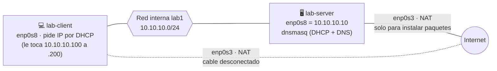

# 1 · TP1 · DHCP y DNS

**La idea:** cuando un equipo se conecta a una red no sabe qué IP usar ni cómo se llaman los demás. **DHCP** le da la IP, el gateway y el DNS. **DNS** traduce nombres (`server.lab.local`) a IPs. Vas a armar las dos cosas con **dnsmasq** en `lab-server`.



## Antes de empezar

- Capítulo 0 terminado.
- Las dos VMs en la red interna `lab1`.
- `lab-client` con el cable del adaptador NAT (`enp0s3`) **desconectado** (capítulo 0, Paso 4.2): en este TP el cliente tiene que recibir IP y DNS solo de dnsmasq.

## Paso 1 · Darle IP fija al servidor

🖥️ `lab-server`, **desde la consola de la VM**. Editá `/etc/netplan/90-default.yaml` (reemplazá todo):

```yaml
network:
  version: 2
  ethernets:
    enp0s3:            # NAT: salida a Internet
      dhcp4: true
    enp0s8:            # LAN del laboratorio
      dhcp4: false
      addresses: [10.10.10.10/24]
```

```bash
# ↓ netplan exige que solo el dueño pueda leer el archivo
sudo chmod 600 /etc/netplan/90-default.yaml

# ↓ aplica la configuración de red (hacelo desde la consola de la VM)
sudo netplan apply

# ↓ muestra la IP de la interfaz; debe decir 10.10.10.10/24
ip -br addr show enp0s8
```

✅ Debe mostrar `10.10.10.10/24`.

*Por qué:* el archivo de fábrica pone DHCP en todas las interfaces, y un servidor DHCP no puede pedirse IP a sí mismo.

## Paso 2 · Configurar dnsmasq

🖥️ `lab-server`. Creá `/etc/dnsmasq.d/tp1.conf`:

```ini
bind-interfaces
interface=enp0s8
domain=lab.local
dhcp-range=10.10.10.100,10.10.10.200,255.255.255.0,1h
dhcp-option=option:router,10.10.10.1
dhcp-option=option:dns-server,10.10.10.10
address=/server.lab.local/10.10.10.10
address=/router.lab.local/10.10.10.1
```

Qué hace cada línea:

| Línea | Significado |
|---|---|
| `bind-interfaces` | Escucha solo en la interfaz indicada (si no, choca con systemd-resolved en el puerto 53) |
| `dhcp-range=…` | Reparte IPs de la .100 a la .200, por 1 hora |
| `option:router` | Le dice al cliente cuál es su gateway |
| `option:dns-server` | Le dice al cliente a quién preguntar los nombres |
| `address=/…/…` | Nombres fijos que el DNS sabe responder |

```bash
# ↓ verifica la sintaxis, reinicia dnsmasq y confirma que quedó activo
sudo dnsmasq --test && sudo systemctl restart dnsmasq && systemctl is-active dnsmasq

# ↓ muestra en qué puertos UDP escucha dnsmasq (con sudo: sin él no se ve el nombre del programa)
sudo ss -lunp | grep dnsmasq
```

✅ Debe decir `active` y verse dnsmasq escuchando en `10.10.10.10:53` (DNS) y `0.0.0.0%enp0s8:67` (DHCP). Que aparezcan también `127.0.0.1:53` o `[::1]:53` es normal.

## Paso 3 · Probar desde el cliente

💻 `lab-client`. Primero reiniciá la red para que pida IP: `sudo networkctl reconfigure enp0s8`.

| Prueba | Comando | Qué debería ver |
|---|---|---|
| IP | `ip -br addr show enp0s8` | `10.10.10.1xx/24` (entre .100 y .200) |
| Gateway | `ip route` | `default via 10.10.10.1 dev enp0s8 proto dhcp` (también aparecen dos rutas `/32` a `10.10.10.1` y `10.10.10.10` con `proto dhcp`: es normal) |
| DNS | `resolvectl status enp0s8` | `DNS Servers: 10.10.10.10` y `DNS Domain: lab.local` |
| Resolver | `dig server.lab.local` | `status: NOERROR`, `A 10.10.10.10` |

> `dig` avisa `WARNING: .local is reserved for Multicast DNS`: es inofensivo, la respuesta igual llega.

**Opcional:** el script `verificar-tp1.sh` hace estas mismas comprobaciones y da PASS/FAIL (con todo bien: 5 PASS). Está en `lab-server`, en `~/guia/scripts/verificar-tp1.sh`; `lab-client` no tiene la guía clonada ni Internet, así que primero tenés que llevarlo al cliente (por ejemplo con `scp`, que necesita un servidor SSH en el cliente, y esta guía no lo instala). Si no lo llevás, la tabla de arriba alcanza. Ya en el cliente: `bash verificar-tp1.sh enp0s8`.

## Paso 4 · Ver el DHCP "por dentro" (la parte que se evalúa)

En 🖥️ `lab-server` empezá a capturar:

```bash
# ↓ captura solo el tráfico DHCP y lo guarda en un archivo
sudo tcpdump -i enp0s8 -n -v -w tp1-dhcp.pcap udp port 67 or udp port 68
```

En 💻 `lab-client`, **una prueba a la vez**:

| Comando en el cliente | Qué se ve en la captura |
|---|---|
| `sudo networkctl renew enp0s8` | Solo **Request + ACK** (renovación: ya tenía IP) |
| `sudo networkctl reconfigure enp0s8` | **Release, Discover, Offer, Request, ACK** (el famoso DORA, completo) |

Cortá la captura con Ctrl+C y abrí `tp1-dhcp.pcap` con Wireshark (filtro `dhcp`). Buscá: Transaction ID, MAC del cliente, opción 53 (tipo de mensaje), *Your IP* y las opciones 3 (router), 6 (DNS), 51 (tiempo de concesión) y 54 (servidor).

## Paso 5 · Provocar una falla a propósito

🖥️ `lab-server`: `sudo systemctl stop dnsmasq`. Después en 💻 `lab-client`:

- `ping -c2 10.10.10.10` → **funciona** (la IP seguía asignada).
- `ping -c2 server.lab.local` → **falla** con `Temporary failure in name resolution` (ya no hay quien traduzca nombres).

Volvé a encender: `sudo systemctl start dnsmasq`.

## Evidencia a guardar

- [ ] `tp1-terminal.log` (comando `script -a`)
- [ ] `tp1-dhcp.pcap` con renovación y con DORA completo
- [ ] Salidas de la tabla del Paso 3
- [ ] Resultado de la falla del Paso 5

## Preguntas para el informe

1. ¿Por qué `renew` no genera un Discover?
2. ¿Existe algún equipo con la IP del gateway que informamos (10.10.10.1)?
3. Con dnsmasq detenido, ¿por qué el cliente conserva su IP?

## Si algo sale mal

| Síntoma | Causa |
|---|---|
| dnsmasq en `failed` | Falta `bind-interfaces` o `interface=` |
| El cliente no recibe IP | dnsmasq apagado, o VMs en redes internas distintas |
| `netplan apply` te dejó sin conexión | Lo hiciste por SSH: usá la consola |

➡️ Siguiente: [`02-tp2-routing-nat.md`](02-tp2-routing-nat.md)
