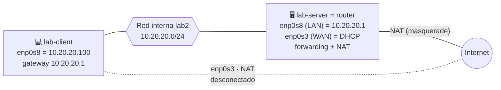

# 2 · TP2 · Gateway, routing y NAT

**La idea:** las IPs de tu red (10.20.20.x) son privadas y no existen en Internet. El **router** reenvía los paquetes (*forwarding*) y el **NAT** cambia la IP de origen por la suya, para que las respuestas vuelvan. Vas a convertir a `lab-server` en ese router.



## Antes de empezar

- TP1 hecho.
- **Apagá las dos VMs** y cambiá la red interna de `lab1` a `lab2` (desde tu PC):

```bash
# ↓ (en tu PC real, con las VMs apagadas) pasa cada VM de la red lab1 a la lab2
VBoxManage modifyvm lab-server --intnet2 lab2

VBoxManage modifyvm lab-client --intnet2 lab2
```

- **Desconectá el NAT de `lab-client`.** Si ya lo hiciste en el capítulo 0 (Paso 4.2), solo verificalo. Con la VM apagada, por comando:

```bash
# ↓ desconecta el "cable" del NAT (adaptador 1) de lab-client, para que solo pueda salir por el router
VBoxManage modifyvm lab-client --cableconnected1 off

# ↓ (Linux) verifica: debe mostrar cableconnected1="off"
VBoxManage showvminfo lab-client --machinereadable | grep cableconnected1
```

```powershell
# ↓ (Windows) verifica: debe mostrar cableconnected1="off"
VBoxManage showvminfo lab-client --machinereadable | Select-String cableconnected1
```

  O desde la interfaz gráfica: VirtualBox → seleccionar `lab-client` → **Configuración → Red → Adaptador 1 → Avanzadas** → desmarcar **Cable conectado**.

> **Más adelante:** el cliente no se usa del TP3 al TP7, así que podés dejarlo desconectado. Si necesitás Internet en `lab-client`, reconectalo con la VM apagada: `VBoxManage modifyvm lab-client --cableconnected1 on` (o marcando **Cable conectado** en la interfaz) y volvelo a desconectar antes de hacer pruebas del TP2.

- Apagá dnsmasq del TP1 en el servidor: `sudo systemctl disable --now dnsmasq`.
- ⚠️ **Condición de validez:** `lab-client` solo puede salir **por el router**. Su NAT (`enp0s3`) tiene que estar **desconectado** (paso de arriba). Si estuviera conectado, saldría a Internet solo y todas las pruebas darían "OK" aunque el router esté mal.

En 💻 `lab-client`, verificá: `ip route` → **una sola** ruta `default`, vía `10.20.20.1`; y `ip -br link` → `enp0s3` sin enlace (`DOWN`; la línea dice algo como `enp0s3 DOWN … <BROADCAST,MULTICAST>`, sin `LOWER_UP`).

## Paso 1 · IPs

🖥️ `lab-server` (consola), `/etc/netplan/90-default.yaml`:

```yaml
network:
  version: 2
  ethernets:
    enp0s3: {dhcp4: true}                                  # WAN
    enp0s8: {dhcp4: false, addresses: [10.20.20.1/24]}     # LAN
```

💻 `lab-client`, `/etc/netplan/90-default.yaml`:

```yaml
network:
  version: 2
  ethernets:
    enp0s8:
      dhcp4: false
      addresses: [10.20.20.100/24]
      routes: [{to: default, via: 10.20.20.1}]
      nameservers: {addresses: [8.8.8.8]}
```

En ambas: `sudo chmod 600 /etc/netplan/90-default.yaml && sudo netplan apply`.

✅ Prueba rápida **antes** de armar el router (en 💻 `lab-client`): confirma que el cliente de verdad no tiene otra salida.

```bash
# ↓ el gateway responde, pero 1.1.1.1 no (todavía no hay router): 100% packet loss
ping -c2 -W2 10.20.20.1

ping -c2 -W3 1.1.1.1
```

## Paso 2 · Activar el forwarding (router)

🖥️ `lab-server`:

```bash
# ↓ deja activado el reenvío de paquetes (lo que convierte a la VM en router)
echo 'net.ipv4.ip_forward = 1' | sudo tee /etc/sysctl.d/99-router.conf

# ↓ aplica el cambio y lo muestra; debe decir 1 (el segundo sysctl también lleva sudo: sin él da "command not found")
sudo sysctl --system && sudo sysctl net.ipv4.ip_forward
```

✅ Debe decir `net.ipv4.ip_forward = 1`.

## Paso 3 · Activar el NAT

🖥️ `lab-server`, `/etc/nftables.conf`:

```text
flush ruleset
table ip nat {
  chain postrouting {
    type nat hook postrouting priority srcnat; policy accept;
    oifname "enp0s3" masquerade
  }
}
```

```bash
# ↓ carga las reglas de NAT y las deja activas en cada arranque
sudo nft -f /etc/nftables.conf && sudo systemctl enable --now nftables
```

## Paso 4 · Pruebas

| Prueba | Dónde | Comando | Debería ver |
|---|---|---|---|
| Gateway | `lab-client` | `ping -c3 10.20.20.1` | responde |
| Salida del router | 🖥️ `lab-server` | `ping -c3 8.8.8.8` | responde |
| Internet | `lab-client`| `ping -c3 1.1.1.1` y `curl -I https://example.com` | responde / `HTTP/2 200` |
| Primer salto | `lab-client`| `traceroute -n 1.1.1.1` | salto 1 = `10.20.20.1` (el router) · salto 2 = `10.0.2.2` (el NAT de VirtualBox, por el NAT doble) |
| NAT visible | `lab-server`| `sudo tcpdump -n -i enp0s8 icmp` y, en otra terminal, `sudo tcpdump -n -i enp0s3 icmp` (mientras tanto, `ping -c3 1.1.1.1` en `lab-client`) | LAN: origen `10.20.20.100` · WAN: origen = IP WAN del router (en VirtualBox suele ser `10.0.2.15`) |

También, en el router:

```bash
# ↓ corre el verificador del TP2; con todo bien muestra 5 PASS
sudo bash ~/guia/scripts/verificar-tp2.sh
```

⚠️ Con `sudo`, si está todo bien, da **5 PASS**. Sin `sudo` marca `FAIL: Regla NAT no encontrada` **por error** (necesita root para leer las reglas de nftables).

## Paso 5 · Romperlo a propósito (para entender qué hace cada pieza)

| Experimento | Comando (en 🖥️) | Resultado |
|---|---|---|
| Sin forwarding | `sudo sysctl -w net.ipv4.ip_forward=0` | El cliente llega al router pero no más allá |
| Sin NAT | `sudo nft flush chain ip nat postrouting` | Los paquetes salen con origen `10.20.20.100` y **no vuelve respuesta** |

Para dejarlo como estaba: `sudo sysctl -w net.ipv4.ip_forward=1` y `sudo nft -f /etc/nftables.conf`.

> ⚠️ **Trampa de conntrack:** el NAT recuerda cada conexión en una tabla (*conntrack*), así que, según el sistema, un `ping` que ya estaba corriendo cuando borraste la regla puede **seguir funcionando** un rato. En las pruebas de esta guía (Debian 12 + nftables) el ping se cortó enseguida, pero **no te fíes de eso**: para el experimento, cortá siempre el `ping` y lanzá uno nuevo (o corré `sudo conntrack -F`).
>
> **NAT doble:** la WAN del router también es privada (10.0.x.x del NAT de VirtualBox). En la captura WAN no vas a ver una IP pública: el origen es `10.0.2.15` (la IP WAN del router), no `10.20.20.100`.
>
> **Ojo al compartir:** `traceroute` muestra saltos reales de tu casa/ISP (`192.168.1.1`, IPs públicas). Si publicás capturas, tapá del salto 3 en adelante.

## Evidencia a guardar

- [ ] `tp2-terminal.log`
- [ ] Capturas LAN y WAN (`sudo tcpdump -w tp2-lan.pcap` / `tp2-wan.pcap`) con NAT, y otra sin NAT
- [ ] `ip route` del cliente (una sola default)

## Si algo sale mal

| Síntoma | Causa |
|---|---|
| Todo "funciona" con el router mal | El cliente tiene su propia salida (¿quedó conectado el cable del NAT del cliente?): mirá `ip route` |
| El cliente no pasa del router | `ip_forward` en 0 |
| Pasa pero no vuelve | Falta el masquerade, o `oifname` no es la interfaz WAN |

➡️ Siguiente: [`03-tp3-vlans-firewall.md`](03-tp3-vlans-firewall.md)
