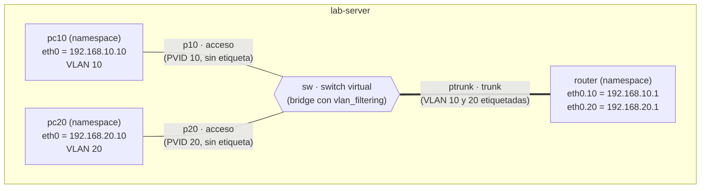

# 3 · TP3 · VLANs, trunk y firewall entre VLANs

**La idea:** una VLAN separa redes **en capa 2**: dos equipos en VLANs distintas no se ven, aunque estén en el mismo cable. Para que se comuniquen hace falta un **router**, y ese router es el lugar donde el **firewall** decide qué se deja pasar. En Wi-Fi esto sirve para que docentes, alumnos e invitados compartan los mismos AP pero estén separados.

Desde acá todo se hace **solo en `lab-server`**, con *namespaces* (cada uno es una "computadora" simulada).

## Vocabulario mínimo

| Término | Qué es |
|---|---|
| Etiqueta 802.1Q | 4 bytes que se agregan a la trama Ethernet con el número de VLAN (VID, de 1 a 4094) |
| Puerto de acceso | Pertenece a **una** VLAN. Las tramas viajan **sin** etiqueta |
| Puerto trunk | Lleva **varias** VLANs, **con** etiqueta |
| Router *on a stick* | Un router con **una** interfaz física y una subinterfaz por VLAN (`eth0.10`, `eth0.20`) |

## Lo que vas a armar



## Antes de empezar

- TP2 hecho. Sacá un snapshot `antes-tp3`.
- La VM puede estar con cualquier red; este TP no usa la red del laboratorio.

## Parte A · El switch y los cables

`lab-server`:

> 💡 **Tip:** para bloques de comandos de varias líneas (como los bucles `for`), podés crear un archivo de script (por ejemplo `crear-switch-vlans.sh`), pegar el bloque de comandos adentro y luego ejecutarlo con `bash crear-switch-vlans.sh`.

```bash
# "computadoras" y router (namespaces)
for n in pc10 pc20 router; do ip netns add $n; ip -n $n link set lo up; done

# switch con filtrado de VLAN
ip link add sw type bridge vlan_filtering 1

ip link set sw up

# cables (veth): un extremo en el switch, el otro en cada equipo
ip link add p10    type veth peer name eth0 netns pc10

ip link add p20    type veth peer name eth0 netns pc20

ip link add ptrunk type veth peer name eth0 netns router
```

Para asociar los puertos al switch virtual y quitarles la VLAN 1 nativa por defecto, podés pegar este bloque directamente o guardarlo en un archivo `asociar-puertos.sh` y ejecutarlo con `bash asociar-puertos.sh`:

```bash
for p in p10 p20 ptrunk; do
  ip link set $p master sw up
  bridge vlan del dev $p vid 1
done
```

Ahora configurá el modo acceso y trunk:

```bash
# acceso: una VLAN, sin etiqueta hacia el equipo
bridge vlan add dev p10 vid 10 pvid untagged

bridge vlan add dev p20 vid 20 pvid untagged

# trunk: varias VLANs, etiquetadas
bridge vlan add dev ptrunk vid 10

bridge vlan add dev ptrunk vid 20

# ↓ muestra qué VLAN tiene cada puerto
bridge vlan show
```

✅ Debe verse: `p10 → 10 PVID Egress Untagged` · `p20 → 20 PVID Egress Untagged` · `ptrunk → 10 y 20`. Además aparece una línea `sw 1 PVID Egress Untagged`: es el propio switch y es normal.

## Parte B · Equipos y router

> 💡 **Tip:** este bloque tiene varias líneas; podés guardarlo en un archivo (por ejemplo `configurar-equipos-router.sh`) y ejecutarlo con `bash configurar-equipos-router.sh`.

```bash
# ↓ le pone IP y gateway a pc10 (y lo mismo a pc20 en las líneas siguientes)
ip -n pc10 addr add 192.168.10.10/24 dev eth0; ip -n pc10 link set eth0 up

ip -n pc10 route add default via 192.168.10.1

ip -n pc20 addr add 192.168.20.10/24 dev eth0; ip -n pc20 link set eth0 up

ip -n pc20 route add default via 192.168.20.1

# ↓ atajo: $R ejecuta el comando adentro del router
R="ip netns exec router"

$R ip link set eth0 up

# ↓ crea las subinterfaces VLAN 10 y 20 sobre la única interfaz del router
$R ip link add link eth0 name eth0.10 type vlan id 10

$R ip link add link eth0 name eth0.20 type vlan id 20

$R ip addr add 192.168.10.1/24 dev eth0.10; $R ip link set eth0.10 up

$R ip addr add 192.168.20.1/24 dev eth0.20; $R ip link set eth0.20 up
```

(La variable `R` solo vive en esa terminal: si abrís otra, volvé a definirla.)

## Parte C · Experimentos, **en este orden**

Primero apagá el reenvío en el router. El TP2 lo dejó **activado en el host** y el namespace `router` hereda ese valor al crearse; si no lo ponés en 0, el experimento 2 responde en vez de fallar. (Usá la variable `R` de la Parte B.)

```bash
# ↓ apaga el reenvío de paquetes dentro del router
$R sysctl -w net.ipv4.ip_forward=0

# ↓ comprobá que quedó en 0
$R sysctl net.ipv4.ip_forward
```

✅ Debe verse: `net.ipv4.ip_forward = 0`.

| # | Estado del router | Prueba | Resultado esperado |
|---|---|---|---|
| 1 | `ip_forward = 0` | pc10 → `192.168.10.1` | ✅ responde |
| 2 | `ip_forward = 0` | pc10 → `192.168.20.10` | ❌ sin respuesta |
| 3 | `ip_forward = 1` | pc10 ↔ pc20 | ✅ en ambos sentidos |
| 4 | + firewall | pc20 → pc10 | ✅ responde |
| 5 | + firewall | pc10 → pc20 | ❌ sin respuesta |

Cada ping se hace así: `ip netns exec pc10 ping -c2 192.168.20.10`.

Para pasar del experimento 2 al 3: `$R sysctl -w net.ipv4.ip_forward=1`. Para el 4 y el 5, cargá el firewall:

> 💡 **Tip:** este bloque tiene varias líneas; podés guardarlo en un archivo (por ejemplo `firewall-tp3.sh`) y ejecutarlo con `bash firewall-tp3.sh`.

```bash
$R nft -f - <<'EOF'
table inet tp3 {
  chain forward {
    type filter hook forward priority filter; policy drop;
    ct state established,related accept
    iifname "eth0.20" oifname "eth0.10" accept comment "docentes -> alumnos"
  }
}
EOF
```

Leela en voz alta: *"Todo lo que se reenvía se descarta, salvo las respuestas a conexiones ya abiertas y lo que viene de la VLAN 20 hacia la VLAN 10."*

## Parte D · Ver la etiqueta 802.1Q

Con **dos terminales** en `lab-server`, mientras pc20 hace ping a pc10:

```bash
# ↓ terminal 1
tcpdump -i ptrunk -e -n icmp

# ↓ terminal 2
tcpdump -i p10 -e -n icmp   

# ↓ terminal 3
ip netns exec pc20 ping -c2 192.168.10.10    
```

Debería verse (recortado):

```text
ptrunk: ... 802.1Q (0x8100), length 102: vlan 20 ... 192.168.20.10 > 192.168.10.10
ptrunk: ... 802.1Q (0x8100), length 102: vlan 10 ... 192.168.20.10 > 192.168.10.10
ptrunk: ... 802.1Q (0x8100), length 102: vlan 10 ... 192.168.10.10 > 192.168.20.10
ptrunk: ... 802.1Q (0x8100), length 102: vlan 20 ... 192.168.10.10 > 192.168.20.10
p10:    ... IPv4 (0x0800),      length  98: 192.168.20.10 > 192.168.10.10: ICMP echo request
p10:    ... IPv4 (0x0800),      length  98: 192.168.10.10 > 192.168.20.10: ICMP echo reply
```

**Cómo leerlo:** por el trunk ves **4 paquetes** por cada eco (ida y vuelta; con `-c2` se repite): el pedido con `vlan 20` (de pc20 al router), el mismo pedido con `vlan 10` (del router a pc10), y después la respuesta con `vlan 10` (de pc10 al router) y con `vlan 20` (del router a pc20). Todos con `length 102`. En p10 solo ves el pedido y la respuesta. En el puerto de acceso llega **sin** etiqueta y 4 bytes más corto (98 vs. 102).

## Evidencia a guardar

- [ ] `tp3-terminal.log`
- [ ] `bridge vlan show`
- [ ] Tabla de los 5 experimentos con lo que viste de verdad
- [ ] Captura del trunk y del puerto de acceso (`-w tp3-trunk.pcap`)

## Preguntas para el informe

1. ¿Por qué el experimento 2 falla si el router tiene IP en ambas VLANs?
2. Explicá la diferencia de 4 bytes entre el trunk y el puerto de acceso.
3. ¿Por qué `ct state established,related accept` deja que pc10 **responda** pero no **inicie**?
4. Poné a pc20 en la subred 192.168.10.0/24 pero dejala en la VLAN 20. ¿Se comunica con pc10? ¿Qué demuestra?
5. En un campus real, ¿en qué equipo estaría cada pieza (switch, trunk, router, firewall, AP)?

## Si algo sale mal

| Síntoma | Causa |
|---|---|
| Todo se comunica con todo | Falta `vlan_filtering 1` en el bridge |
| Nada pasa por el trunk | Falta `bridge vlan add dev ptrunk vid X`, o quedó la VLAN 1 |
| El router no responde en una VLAN | Subinterfaz sin `up` o creada sobre la interfaz equivocada |
| Con firewall no vuelven las respuestas | Falta `ct state established,related accept` |

## Limpiar antes de seguir

```bash
# ↓ borra los equipos, el router y el switch para dejar todo limpio
for n in pc10 pc20 router; do ip netns del $n; done; ip link del sw
```

➡️ Siguiente: [`04-tp4-portal-cautivo.md`](04-tp4-portal-cautivo.md)
