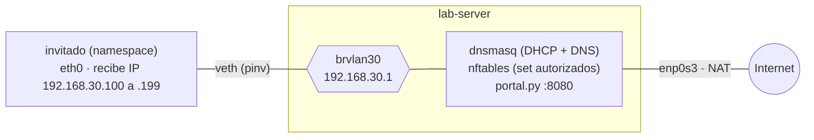

# 4 · TP4 · Portal cautivo

**La idea:** en un Wi-Fi de invitados, hasta que no aceptás los términos solo podés hablar con el portal. El "login" es, en el fondo, **una regla de firewall para tu IP**.

## Cómo funciona (en 5 pasos)

1. El invitado se conecta a un Wi-Fi **abierto** y recibe IP por DHCP.
2. El firewall lo trata como **no autorizado**: solo deja pasar DHCP, DNS y el portal.
3. Cuando el navegador pide una página **HTTP**, el gateway la **redirige** (DNAT) al portal.
4. El usuario acepta y el portal agrega su IP a una **lista de autorizados**, con vencimiento.
5. Desde ese momento el firewall lo deja salir a Internet.

**Lo que NO se puede hacer:** redirigir **HTTPS** sin romper TLS (el navegador esperaba el certificado de `example.com` y recibiría el del portal). Por eso los sistemas operativos detectan el portal con un pedido **HTTP** de prueba (Android: `connectivitycheck.gstatic.com/generate_204`; Apple: `captive.apple.com/hotspot-detect.html`).

## Lo que vas a armar



## Antes de empezar

- TP3 hecho (y limpiado), snapshot `antes-tp4`.
- dnsmasq del TP1 apagado: `systemctl stop dnsmasq` (lo vas a reconfigurar).
- Forwarding activo: `sysctl -w net.ipv4.ip_forward=1`.

## Paso 1 · El bridge y el invitado

`lab-server`:

> 💡 **Tip:** este bloque tiene varias líneas; podés guardarlo en un archivo (por ejemplo `crear-bridge-invitado.sh`) y ejecutarlo con `bash crear-bridge-invitado.sh`.

```bash
# ↓ crea el bridge de invitados y lo enciende
ip link add brvlan30 type bridge && ip link set brvlan30 up

# ↓ le da la IP del gateway de invitados
ip addr add 192.168.30.1/24 dev brvlan30

# ↓ crea el 'equipo' invitado (un namespace)
ip netns add invitado && ip -n invitado link set lo up

# ↓ cable virtual entre el invitado y el bridge
ip link add pinv type veth peer name eth0 netns invitado

ip link set pinv master brvlan30 up

ip -n invitado link set eth0 up

# ↓ le da al invitado su propio resolv.conf (así no pisa el del sistema)
mkdir -p /etc/netns/invitado && touch /etc/netns/invitado/resolv.conf
```

## Paso 2 · DHCP y DNS para invitados
Guarda (hacer backup) la configuracion de dnsmasq del TP1 con `mv /etc/dnsmasq.d/tp1.conf /root/tp1.conf.bak`.

Con `touch` crea `/etc/dnsmasq.d/tp4.conf`,

En `/etc/dnsmasq.d/tp4.conf` agrega:

```ini
bind-interfaces
interface=brvlan30
dhcp-range=set:invitados,192.168.30.100,192.168.30.199,255.255.255.0,30m
dhcp-option=tag:invitados,option:router,192.168.30.1
dhcp-option=tag:invitados,option:dns-server,192.168.30.1
server=1.1.1.1
```
Verifica la configuracion si esta correcta y reinicia el servicio de dnsmasq: 

```bash
dnsmasq --test && systemctl restart dnsmasq
```

## Paso 3 · Firewall con lista de autorizados

La pieza central es un **set** de nftables con vencimiento. Si iniciaste sesion en root guardalo usando nano `~/tp4.nft`, sino `nano /root/tp4.nft`. Esta config usa `enp0s3` como salida a Internet:

> La tabla se llama `tp7` porque usaremos la misma para el TP7; así el portal sirve para ambos.
```text
table inet tp7 {
  set autorizados {
    type ipv4_addr
    flags timeout
    timeout 1h
  }
  chain prerouting {
    type nat hook prerouting priority dstnat;
    iifname "brvlan30" ip saddr != @autorizados tcp dport 80 dnat ip to 192.168.30.1:8080
  }
  chain forward {
    type filter hook forward priority filter; policy drop;
    ct state established,related accept
    iifname "brvlan30" oifname "enp0s3" ip saddr @autorizados accept
    counter log prefix "TP7-DROP "
  }
  chain postrouting {
    type nat hook postrouting priority srcnat;
    oifname "enp0s3" masquerade
  }
}
```

```bash
# ↓ carga el firewall con la lista de autorizados
nft -f /root/tp4.nft
```

Leelo en voz alta: *"Si viene de invitados, no está autorizado y va al puerto 80, cambiá el destino al portal. A Internet solo pasan los autorizados. Lo demás se descarta y se registra."*

## Paso 4 · El portal

El portal es un script de 25 líneas que esta en:`~/guia/configs/portal.py` en el `lab-server`, sirve una página.

Arega la IP del cliente al set:
   
   ```bash
   nft add element inet tp7 autorizados { <IP_DEL_CLIENTE> }
   ```
   
### Ponerlo en marcha


```bash
# ↓ copia el portal a /opt/portal
install -D ~/guia/configs/portal.py /opt/portal/portal.py

# ↓ lo ejecuta en segundo plano (tiene que correr como root)
python3 /opt/portal/portal.py &
```

**Detalles importantes de estos comandos:**
- `install -D`: Copia el archivo y crea automáticamente la carpeta `/opt/portal` si no existía, dejándolo en una ubicación limpia del sistema.
- El `&` al final: Ejecuta el servidor en segundo plano (*background*) para no dejar la terminal bloqueada y poder seguir usándola.
- **Tiene que correr como root:** Como el script interactúa directamente con el firewall ejecutando comandos de `nft` mediante `subprocess`, necesita privilegios de administrador. Si se corriera como usuario común, la llamada a `nft` fallaría con error de permisos, la IP nunca entraría a la lista de autorizados y el invitado se quedaría siempre atrapado en el portal.

## Paso 5 · Experimento completo

Desde `lab-server`, el invitado pide IP: `ip netns exec invitado dhclient -v eth0`. Después, en este orden:

| # | Comando (con `ip netns exec invitado` adelante) | Qué debería pasar |
|---|---|---|
| 1 | `curl http://example.com` | Ves `<h1>Wi-Fi Invitados UNCuyo</h1>` → **es el portal**, no example.com |
| 2 | `curl https://example.com` | `Connection timed out` → HTTPS no se redirige, se descarta |
| 3 | `ping -c2 1.1.1.1` | bloqueado |
| 4 | `curl http://example.com/aceptar` | `Acceso concedido` |
| 5 | `curl http://example.com` | `<title>Example Domain</title>` → el sitio real |
| 6 | `curl -s -o /dev/null -w "%{http_code}\n" https://example.com` | `200` |

⏳ El experimento 2 (`curl https://example.com`) sin tiempo máximo tarda **unos 2 minutos** en dar `Connection timed out`. No lo cortes, o usá `curl --max-time 10 https://example.com`.

`dhclient` le entrega al invitado una IP entre `192.168.30.100` y `.199` (en las pruebas fue `192.168.30.150`; la tuya puede ser otra).

Para ver quién está autorizado y cuánto le queda: `nft list set inet tp7 autorizados`. Después del experimento 4 verás algo como:

```text
elements = { 192.168.30.150 expires 59m59s656ms }
```

## Evidencia a guardar

- [ ] `tp4-terminal.log`
- [ ] Tabla de los 6 pasos con tu resultado
- [ ] Captura del paso 1 en el invitado y en el portal (para ver el cambio de IP destino)
- [ ] `nft list set inet tp7 autorizados`

## Preguntas para el informe

1. En el paso 1, ¿qué IP destino tiene el paquete que sale del cliente? ¿Y el que llega al portal? ¿Dónde se hizo el cambio?
2. ¿Por qué el paso 2 termina en *timeout* y no en un error?
3. ¿Qué pasaría si el portal autorizara por **MAC**? ¿Es más seguro?
4. El DNS del invitado funciona **antes** de aceptar. ¿Por qué hace falta? (Pista: sin DNS, ¿habría pedido HTTP que redirigir?)
5. ¿Qué rol cumple el `timeout 1h`? ¿Cómo lo reemplaza un portal comercial?

## Si algo sale mal

| Síntoma | Causa |
|---|---|
| El portal no aparece | DNAT sobre la interfaz equivocada, o el portal escucha en otra IP/puerto |
| Después de aceptar sigue el portal | La IP no entró al set (el portal no corre como root) o está en otra tabla |
| Invitado sin IP | dnsmasq sin `interface=brvlan30`, o el bridge no existía al iniciar dnsmasq |
| Autorizado pero sin Internet | Falta masquerade o `ip_forward = 0` |

## Limpiar antes de seguir

> 💡 **Tip:** este bloque tiene varias líneas; podés guardarlo en un archivo (por ejemplo `limpiar-tp4.sh`) y ejecutarlo con `bash limpiar-tp4.sh`.

```bash
pkill -f portal.py; nft delete table inet tp7

# ↓ primero apagá el dhclient del Paso 5 (si no, sigue vivo dentro del namespace)
pkill dhclient

ip netns del invitado; ip link del brvlan30

rm /etc/dnsmasq.d/tp4.conf; systemctl stop dnsmasq
```

⚠️ El `dhclient` del Paso 5 mantiene vivo el namespace y deja el veth `pinv` huérfano; si no lo matás, al repetir el TP4 el `ip link add pinv ...` falla con `File exists`.

➡️ Siguiente: [`05-tp6-wifi-virtual.md`](05-tp6-wifi-virtual.md) *(el TP6 va antes que el TP5)*
