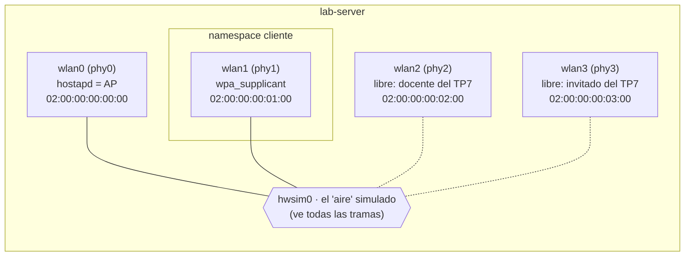

# 5 · TP6 · Wi-Fi completamente virtual

> **Por qué este capítulo va antes que el TP5:** el TP5 (RADIUS) usa la radio virtual y el namespace `cliente` que se arman acá.

**La idea:** `mac80211_hwsim` es un módulo del kernel que crea **radios Wi-Fi falsas pero reales para el sistema**: `hostapd` (AP) y `wpa_supplicant` (cliente) funcionan sin cambios. Además crea `hwsim0`, una interfaz que ve **todas** las tramas del "aire", con lo que podés capturar beacons, asociación y el handshake.



## Antes de empezar

- TP4 terminado y limpiado. Snapshot `antes-tp6`.
- Paquetes `hostapd`, `wpasupplicant`, `iw`, `tshark` instalados (capítulo 0).

## Paso 1 · Crear las radios y el namespace

`lab-server`:

> 💡 **Tip:** este bloque tiene varias líneas; podés guardarlo en un archivo (por ejemplo `crear-radios-wifi.sh`) y ejecutarlo con `bash crear-radios-wifi.sh`.

```bash
# ↓ carga el módulo que crea 4 radios Wi-Fi virtuales
modprobe mac80211_hwsim radios=4

# ↓ lista las interfaces Wi-Fi y a qué phy pertenece cada una
iw dev

# ↓ enciende hwsim0, la interfaz que ve todo el 'aire'
ip link set hwsim0 up

# ↓ crea el namespace que va a hacer de cliente
ip netns add cliente

# ↓ mueve la radio phy1 adentro del cliente
iw phy phy1 set netns name cliente

ip -n cliente link set lo up
```

- `radios=4` crea `wlan0` (AP) y `wlan1`, `wlan2`, `wlan3` (clientes). En este TP se usa solo `wlan1`; `wlan2` y `wlan3` se usan en el TP7 (docente e invitado).
- Se mueve el **phy**, no la interfaz. Con `iw dev` anotá qué phy tiene cada wlan.
- Si recargás el módulo sin reiniciar, los números cambian (`phy3`, `phy4`…). **Mirá siempre `iw dev`.** Para empezar de cero: `rmmod mac80211_hwsim`.

## Paso 2 · Configurar AP y cliente (WPA2-PSK)

`/etc/hostapd/tp6-psk.conf`:

```ini
interface=wlan0
driver=nl80211
ssid=WIFI-UNCUYO
hw_mode=g
channel=6
wpa=2
wpa_key_mgmt=WPA-PSK
rsn_pairwise=CCMP
wpa_passphrase=laboratorio123
ctrl_interface=/run/hostapd
```

`/root/tp6-wpa.conf`:

```ini
ctrl_interface=/run/wpa_supplicant
network={
  ssid="WIFI-UNCUYO"
  psk="laboratorio123"
  key_mgmt=WPA-PSK
}
```

## Paso 3 · Encender todo y capturar

> 💡 **Tip:** este bloque tiene varias líneas; podés guardarlo en un archivo (por ejemplo `encender-ap-cliente.sh`) y ejecutarlo con `bash encender-ap-cliente.sh`.

```bash
# ↓ empieza a capturar el 'aire'
tcpdump -i hwsim0 -w tp6.pcap &

# ↓ enciende el AP (-B = en segundo plano)
hostapd -B /etc/hostapd/tp6-psk.conf

# ↓ conecta el cliente al AP
ip netns exec cliente wpa_supplicant -B -i wlan1 -c /root/tp6-wpa.conf -f /root/wpa-tp6.log

# ↓ espera a que termine de asociarse (tarda ~10 s, por eso 20)
sleep 20

# ↓ muestra si el cliente quedó conectado
ip netns exec cliente iw dev wlan1 link
```

✅ Debería mostrar `Connected to 02:00:00:00:00:00`, `SSID: WIFI-UNCUYO`, `freq: 2437`. En `/root/wpa-tp6.log` buscá `Key negotiation completed ... [PTK=CCMP GTK=CCMP]` y `CTRL-EVENT-CONNECTED`.

> La asociación tarda unos 10 segundos. Si dice `Not connected.`: esperá un poco más y mirá el log **antes** de decidir que falló. Si sigue, revisá que hostapd diga `AP-ENABLED`, que movieras el phy correcto, y que exista `/etc/hostapd/`.

## Paso 4 · Leer la captura

Parar la captura (`pkill tcpdump`) y analizar:

```bash
tshark -r tp6.pcap -Y "wlan.fc.type_subtype==8" | head -2

tshark -r tp6.pcap -Y "wlan.fc.type_subtype==4 or wlan.fc.type_subtype==5" | head

tshark -r tp6.pcap -Y "eapol or wlan.fc.type_subtype==0 or wlan.fc.type_subtype==1 or wlan.fc.type_subtype==11"
```

La conexión completa, **en orden cronológico**:

| # | Trama | Qué pasa |
|---|---|---|
| 1 | **Beacon** (subtipo 8) | El AP anuncia el SSID ~10 veces por segundo |
| 2 | **Probe Request** (4) | El cliente pregunta "¿hay redes?" (suele mandar varios antes de recibir la respuesta) |
| 3 | **Probe Response** (5) | El AP responde |
| 4 | **Authentication** ×2 (11) | "Open System": en WPA2 no autentica nada todavía |
| 5 | **Association Request/Response** (0/1) | El cliente se une; se negocian capacidades y cifrado |
| 6 | **EAPOL 1, 2, 3, 4** | **4-way handshake**: de la PMK salen la PTK (unicast) y la GTK (grupo) |

## Extensión · WPA3 (SAE)

Los archivos ya vienen hechos en `lab-server`: `~/guia/configs/hostapd-tp6-sae.conf` y `wpa-tp6-sae.conf`. Cambian respecto del WPA2: `ssid=WIFI-UNCUYO-WPA3`, `channel=11`, `wpa_key_mgmt=SAE`, `sae_password=laboratorio123` (en lugar de `wpa_passphrase`) y `ieee80211w=2` en el AP; `key_mgmt=SAE`, `sae_password="laboratorio123"` e `ieee80211w=2` en el cliente.

Antes apagá el AP y el cliente del paso anterior y arrancá los de WPA3:

> 💡 **Tip:** este bloque tiene varias líneas; podés guardarlo en un archivo (por ejemplo `wpa3-sae.sh`) y ejecutarlo con `bash wpa3-sae.sh`.

```bash
# ↓ apaga el AP y el cliente del paso anterior
pkill hostapd; ip netns exec cliente pkill wpa_supplicant

# ↓ enciende el AP WPA3 (-B = en segundo plano)
hostapd -B ~/guia/configs/hostapd-tp6-sae.conf

# ↓ conecta el cliente al AP WPA3
ip netns exec cliente wpa_supplicant -B -i wlan1 -c ~/guia/configs/wpa-tp6-sae.conf -f /root/wpa-tp6-sae.log

# ↓ espera a que termine de asociarse
sleep 20

# ↓ muestra si el cliente quedó conectado
ip netns exec cliente iw dev wlan1 link
```

✅ Probado: `Connected to 02:00:00:00:00:00`, `SSID: WIFI-UNCUYO-WPA3`, `freq: 2462`. En la captura (si la arrancás igual que en el paso 3), la autenticación pasa de 2 tramas "Open System" a **4 tramas Authentication** (SAE Commit y Confirm en cada sentido), y después el 4-way handshake.

## Evidencia a guardar

- [ ] `tp6-terminal.log`, `tp6.pcap`
- [ ] Salida de `iw dev wlan1 link`
- [ ] Log del supplicant con `CTRL-EVENT-CONNECTED`
- [ ] Tabla de tramas con las MAC reales de tu captura

## Preguntas para el informe

1. ¿Qué campos del Beacon dicen que la red usa WPA2 y CCMP? (Buscá el *RSN Information Element*.)
2. En WPA2-PSK las tramas "Authentication" no autentican a nadie. ¿Dónde se prueba que el cliente conoce la clave?
3. Con los 4 mensajes EAPOL y un diccionario, un atacante puede probar adivinar una PSK débil sin estar conectado. ¿Por qué? ¿Qué cambia SAE?
4. ¿Por qué el cliente tiene que estar en un namespace y no en `lab-client`?

## Dejar listo para el TP5

Apagá el AP y el cliente (el namespace `cliente` y las radios **se quedan**):

```bash
pkill hostapd; ip netns exec cliente pkill wpa_supplicant; pkill tcpdump
```

➡️ Siguiente: [`06-tp5-radius-8021x.md`](06-tp5-radius-8021x.md)
