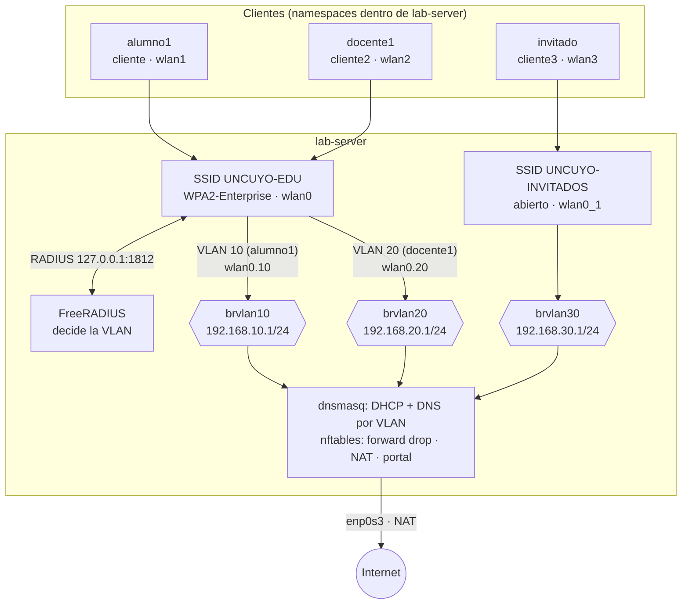

# 7 · TP7 · Integrador

**La idea:** juntar todo lo anterior. Una universidad con **docentes, alumnos e invitados**, donde **RADIUS decide en qué VLAN cae cada usuario**, los invitados pasan por el portal, y un firewall controla qué red puede hablar con cuál.



| Red | VLAN | Bridge / gateway | Acceso |
|---|---|---|---|
| Alumnos | 10 | `brvlan10` · 192.168.10.1 | Internet |
| Docentes | 20 | `brvlan20` · 192.168.20.1 | Internet + red de alumnos |
| Invitados | 30 | `brvlan30` · 192.168.30.1 | Solo el portal; después, Internet |

## Antes de empezar

- TP4, TP6 y TP5 hechos y limpiados (sin hostapd, wpa_supplicant, portal ni dnsmasq corriendo). Snapshot `antes-tp7`.
- Las 4 radios `hwsim` (`wlan0` a `wlan3`) y el namespace `cliente` del TP6 existen (`iw dev`). Si en el TP6 cargaste solo 3, volvé a empezar con `rmmod mac80211_hwsim` y `radios=4`.
- Archivos de apoyo en `lab-server`, en `~/guia/configs/`: `hostapd-tp7-multi.conf`, `hostapd-tp7.vlan`, `freeradius-fragmentos.txt`, `dnsmasq-tp7.conf`, `nftables-tp7.conf`, `portal.py`, `wpa-invitado.conf`.

## Paso 1 · RADIUS asigna la VLAN

En `/etc/freeradius/3.0/mods-config/files/authorize`, **al principio**, reemplazá los usuarios del TP5 por:

```text
alumno1   Cleartext-Password := "alumno123"
          Tunnel-Type = VLAN,
          Tunnel-Medium-Type = IEEE-802,
          Tunnel-Private-Group-Id = "10"

docente1  Cleartext-Password := "docente123"
          Tunnel-Type = VLAN,
          Tunnel-Medium-Type = IEEE-802,
          Tunnel-Private-Group-Id = "20"
```

La VLAN viaja en tres atributos RADIUS estándar (RFC 3580). Probalo:

```bash
# ↓ pide el acceso del docente y mirá si vuelven los atributos de VLAN
radtest docente1 docente123 127.0.0.1 0 testing123
```

✅ El `Access-Accept` debe incluir `Tunnel-Type = VLAN`, `Tunnel-Medium-Type = IEEE-802` y `Tunnel-Private-Group-Id = "20"`. En la salida real de `radtest` los vas a ver como `Tunnel-Type:0 = VLAN`: ese `:0` es la etiqueta (*tag*) del atributo y es normal.

## Paso 2 · ⚠ El detalle que hace fallar a casi todos

Con `radtest` los atributos aparecen, pero **con PEAP el AP no los recibe**. hostapd dice:

```text
IEEE 802.1X: authentication server did not include required VLAN ID in Access-Accept
```

**Por qué:** en PEAP, el usuario se autentica **dentro del túnel TLS**, que FreeRADIUS procesa en el sitio virtual `inner-tunnel`. Ahí se agregan los atributos de VLAN, pero el `Access-Accept` que viaja al AP se arma en el sitio **externo** (`default`), que no los tiene.

**Solución** (FreeRADIUS 3.2): al principio de `post-auth` en `/etc/freeradius/3.0/sites-available/inner-tunnel`:

```text
post-auth {
	update outer.session-state {
		&Tunnel-Type := &reply:Tunnel-Type
		&Tunnel-Medium-Type := &reply:Tunnel-Medium-Type
		&Tunnel-Private-Group-Id := &reply:Tunnel-Private-Group-Id
	}
	...
```

(El sitio `default` ya copia `session-state` al `Access-Accept` final.)

✔️ Verificado en las VMs: sin este bloque hostapd rechaza con `did not include required VLAN ID` y el cliente queda `Not connected`; con el bloque aparece `RADIUS: VLAN ID 10` y conecta.

```bash
# ↓ valida la configuración de FreeRADIUS
freeradius -XC | tail -1       # Configuration appears to be OK

systemctl restart freeradius
```

## Paso 3 · hostapd con VLAN dinámica y dos SSID

`/etc/hostapd/tp7.vlan` (formato: `VID  interfaz  bridge`):

```text
10 wlan0.10 brvlan10
20 wlan0.20 brvlan20
```

El archivo completo es `hostapd-tp7-multi.conf` → copialo a `/etc/hostapd/tp7-multi.conf`. Es la configuración del TP5 más estas líneas al final:

```ini
dynamic_vlan=2                     # 2 = obligatoria: sin VLAN en el Accept, se rechaza
vlan_file=/etc/hostapd/tp7.vlan

bss=wlan0_1                        # segundo SSID en la misma radio
ssid=UNCUYO-INVITADOS
bridge=brvlan30                    # el bridge debe existir antes de iniciar hostapd
ctrl_interface=/run/hostapd
```

```bash
# ↓ copia el archivo de VLAN y la configuración completa del AP a /etc/hostapd
cp ~/guia/configs/hostapd-tp7.vlan /etc/hostapd/tp7.vlan

cp ~/guia/configs/hostapd-tp7-multi.conf /etc/hostapd/tp7-multi.conf

# ↓ crea el bridge de invitados (tiene que existir antes que hostapd)
ip link add brvlan30 type bridge && ip link set brvlan30 up

# ↓ enciende el AP con los dos SSID
hostapd -B -f /root/hostapd-tp7.log /etc/hostapd/tp7-multi.conf

# ↓ muestra las interfaces Wi-Fi y sus SSID
iw dev | grep -E "Interface|ssid"
```

✅ Deberías ver `wlan0` (UNCUYO-EDU), `wlan0_1` (UNCUYO-INVITADOS), `wlan0.10` y `wlan0.20`. Estas dos últimas (y los bridges `brvlan10` y `brvlan20`) las crea hostapd apenas arranca; no hace falta que se conecte nadie. Ahora ponele IP a los bridges:

```bash
ip addr add 192.168.10.1/24 dev brvlan10

ip addr add 192.168.20.1/24 dev brvlan20

ip addr add 192.168.30.1/24 dev brvlan30
```

> `dynamic_vlan=1` aceptaría clientes sin VLAN; con `2` quien no tenga VLAN **no entra** (más seguro).
> Asigná las IPs **antes** de arrancar dnsmasq (Paso 4): necesita los tres bridges con su IP al arrancar. Si por algo `brvlan10`/`brvlan20` no aparecen (`ip link show brvlan10`), revisá `/root/hostapd-tp7.log`.

## Paso 4 · DHCP y DNS por VLAN

`dnsmasq-tp7.conf` → `/etc/dnsmasq.d/tp7.conf`. Usa **etiquetas** (`set:` / `tag:`) para dar a cada red su rango, su gateway y su DNS:

```ini
bind-interfaces
interface=brvlan10
interface=brvlan20
interface=brvlan30
except-interface=lo
domain=campus.lab
dhcp-range=set:alumnos,192.168.10.100,192.168.10.199,255.255.255.0,1h
dhcp-range=set:docentes,192.168.20.100,192.168.20.199,255.255.255.0,1h
dhcp-range=set:invitados,192.168.30.100,192.168.30.199,255.255.255.0,30m
dhcp-option=tag:alumnos,option:router,192.168.10.1
dhcp-option=tag:docentes,option:router,192.168.20.1
dhcp-option=tag:invitados,option:router,192.168.30.1
dhcp-option=tag:alumnos,option:dns-server,192.168.10.1
dhcp-option=tag:docentes,option:dns-server,192.168.20.1
dhcp-option=tag:invitados,option:dns-server,192.168.30.1
address=/portal.campus.lab/192.168.10.1
server=1.1.1.1
```

```bash
# ↓ copia la configuración de dnsmasq de este TP (no se reinicia todavía: primero hay que asignar las IPs a los bridges)
cp ~/guia/configs/dnsmasq-tp7.conf /etc/dnsmasq.d/tp7.conf
```

dnsmasq con `bind-interfaces` **necesita que los bridges existan al arrancar**. Reiniciálo cuando estén (con las IPs ya asignadas del Paso 3):

```bash
# ↓ verifica la configuración y reinicia dnsmasq
dnsmasq --test && systemctl restart dnsmasq
```

## Paso 5 · Firewall y portal

Conviene hacerlo **antes** de conectar a los invitados.

> 💡 **Tip:** este bloque tiene varias líneas; podés guardarlo en un archivo (por ejemplo `firewall-y-portal.sh`) y ejecutarlo con `bash firewall-y-portal.sh`.

```bash
# ↓ cambia el nombre de la interfaz de salida y carga el firewall
sed 's/enp1s0/enp0s3/g' ~/guia/configs/nftables-tp7.conf | nft -f -

sysctl -w net.ipv4.ip_forward=1

install -D ~/guia/configs/portal.py /opt/portal/portal.py

python3 /opt/portal/portal.py &
```

(El `sed` cambia el nombre de la interfaz de salida a la de VirtualBox.)

## Paso 6 · Conectar los clientes

> 💡 **Tip:** este bloque tiene varias líneas; podés guardarlo en un archivo (por ejemplo `conectar-alumno-docente.sh`) y ejecutarlo con `bash conectar-alumno-docente.sh`.

```bash
# segundo cliente inalámbrico (docente) en su propio namespace
ip netns add cliente2

iw phy phy2 set netns name cliente2        # verificá el número con iw dev

ip -n cliente2 link set lo up

sed -e 's/identity="alumno1"/identity="docente1"/; s/password="alumno123"/password="docente123"/' /root/tp5-wpa.conf | tee /root/tp7-docente.conf >/dev/null

for ns in cliente cliente2; do mkdir -p /etc/netns/$ns; touch /etc/netns/$ns/resolv.conf; done

ip netns exec cliente  wpa_supplicant -B -i wlan1 -c /root/tp5-wpa.conf     -f /root/wpa-alumno.log

ip netns exec cliente2 wpa_supplicant -B -i wlan2 -c /root/tp7-docente.conf -f /root/wpa-docente.log

sleep 10

ip netns exec cliente  dhclient -v wlan1

ip netns exec cliente2 dhclient -v wlan2

grep "VLAN ID" /root/hostapd-tp7.log
```

✅ `grep` debe mostrar `VLAN ID 10` (alumno) y `VLAN ID 20` (docente).

El `/etc/netns/<ns>/resolv.conf` vacío hace que el DNS que recibe cada cliente no pise el del sistema.

**Invitado:** tercer cliente inalámbrico, en su propio namespace, con `wpa-invitado.conf` (SSID abierto, `key_mgmt=NONE`):

> 💡 **Tip:** este bloque tiene varias líneas; podés guardarlo en un archivo (por ejemplo `conectar-invitado.sh`) y ejecutarlo con `bash conectar-invitado.sh`.

```bash
# ↓ tercer cliente inalámbrico (invitado) en su propio namespace

ip netns add cliente3

iw phy phy3 set netns name cliente3        # verificá el número con iw dev

ip -n cliente3 link set lo up

mkdir -p /etc/netns/cliente3 && touch /etc/netns/cliente3/resolv.conf

ip netns exec cliente3 wpa_supplicant -B -i wlan3 -c ~/guia/configs/wpa-invitado.conf -f /root/wpa-invitado.log

sleep 10

ip netns exec cliente3 dhclient -v wlan3
```

Para las pruebas del Paso 7, cada usuario se prueba desde su namespace: `ip netns exec cliente ...` (alumno), `cliente2` (docente) y `cliente3` (invitado).

## Paso 7 · Matriz de pruebas

Completá esta tabla **con lo que ves vos**. Lo de la columna derecha es lo esperado.

| Prueba | Debería pasar |
|---|---|
| `alumno1` se conecta a UNCUYO-EDU | hostapd: `VLAN ID 10` · DHCP: `192.168.10.1xx` |
| `docente1` se conecta a UNCUYO-EDU | hostapd: `VLAN ID 20` · DHCP: `192.168.20.1xx` |
| DNS en la VLAN 10 | `nameserver 192.168.10.1` · `dig portal.campus.lab` → `192.168.10.1` |
| Alumno → gateway | ✅ |
| Alumno → Internet (`ping 1.1.1.1`, `curl https://example.com`) | ✅ · `200` |
| Alumno → docente | ❌ bloqueado y el log muestra `TP7-DROP IN=brvlan10 OUT=brvlan20 …` |
| Docente → alumno | ✅ |
| Docente → Internet | ✅ |
| Invitado antes de aceptar | HTTP → portal · HTTPS → timeout · ping → bloqueado |
| Invitado después de aceptar | HTTP → Example Domain · HTTPS → `200` |

Para ver los descartes: `journalctl -k | grep TP7-DROP`.

> En la prueba real con VMs: alumno `192.168.10.161`, docente `192.168.20.160`, invitado `192.168.30.159`. Tus IPs exactas van a variar (están en el rango `.100`-`.199`). El primer `TP7-DROP` del log puede venir de un TP anterior (por ejemplo el TP4) si no reiniciaste la VM.

## Limpiar al terminar

El TP7 deja corriendo el AP, tres clientes Wi-Fi, el portal y dnsmasq. Cuando termines de tomar las evidencias, dejá la VM limpia:

> 💡 **Tip:** este bloque tiene varias líneas; podés guardarlo en un archivo (por ejemplo `limpiar-tp7.sh`) y ejecutarlo con `bash limpiar-tp7.sh`.

```bash
# ↓ apaga el AP, los clientes Wi-Fi, los dhclient y el portal
pkill hostapd; pkill wpa_supplicant; pkill dhclient; pkill -f portal.py

# ↓ borra el firewall del TP7
nft delete table inet tp7

# ↓ apaga dnsmasq y borra su configuración del TP7
systemctl stop dnsmasq; rm /etc/dnsmasq.d/tp7.conf

# ↓ borra los tres namespaces de clientes (las radios vuelven al sistema)
for ns in cliente cliente2 cliente3; do ip netns del $ns; done

# ↓ borra el bridge de invitados (los de VLAN 10 y 20 los borra hostapd al apagarse)
ip link del brvlan30

# ↓ descarga las radios virtuales (opcional: para empezar de cero)
rmmod mac80211_hwsim
```

Apagá primero los procesos (`pkill`) y recién después borrá los namespaces: un `dhclient` vivo mantiene vivo su namespace.

## Entregables

1. Diagrama de arquitectura con VLANs, bridges, IPs y servicios.
2. Todas las configuraciones (hostapd, archivo VLAN, FreeRADIUS, dnsmasq, nftables, portal).
3. La matriz de pruebas **propia**, con evidencia de cada fila.
4. Capturas: RADIUS con los atributos de VLAN, aire (EAPOL de ambos usuarios), DHCP en cada VLAN, un intento bloqueado con su línea de log.
5. Análisis de seguridad: qué protege cada capa (802.1X, VLAN, firewall, portal) y qué **no** protege.

## Si algo sale mal

| Síntoma | Causa |
|---|---|
| `did not include required VLAN ID` | Falta el bloque `update outer.session-state` (Paso 2) |
| dnsmasq no entrega IP en una VLAN | El bridge no existía al arrancar dnsmasq: reiniciá dnsmasq |
| Desaparecieron las IPs de los bridges | Algo reinició systemd-networkd (`netplan apply`): reasignalas |
| Invitado: el portal no aparece | Revisá el DNAT y que `portal.py` corra como root |

## Para ir más allá (opcional)

Servicios persistentes con systemd · EAP-TLS con certificados de cliente · *Accounting* RADIUS (UDP 1813) · SSID de invitados cifrado con OWE.

➡️ Siguiente (opcional): [`08-mikrotik-opcional.md`](08-mikrotik-opcional.md) · Errores y glosario: [`Fallas-y-Glosario.md`](Fallas-y-Glosario.md)
