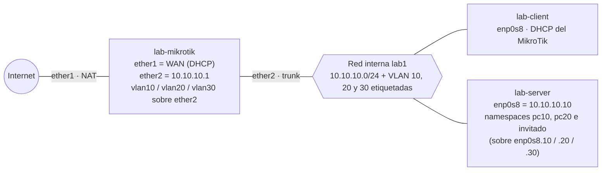

# 8 · (Optativo) Repetir TP1–TP4 en un MikroTik

**La idea:** lo que hiciste con Linux (DHCP, DNS, NAT, VLANs, firewall, portal) lo hace en la vida real un **router dedicado**. Acá lo repetís en **MikroTik RouterOS** para ver que **los conceptos son los mismos y solo cambia la sintaxis**.

| Concepto | Linux | RouterOS |
|---|---|---|
| IP de una interfaz | netplan / `ip addr` | `/ip address` |
| DHCP | dnsmasq `dhcp-range` | `/ip pool` + `/ip dhcp-server` + `/ip dhcp-server network` |
| DNS local | dnsmasq `address=/…/` | `/ip dns` + `/ip dns static` |
| NAT | nftables `masquerade` | `/ip firewall nat … action=masquerade` |
| Firewall | nftables `input` / `forward` | `/ip firewall filter` |
| Subinterfaz VLAN | `ip link add … type vlan` | `/interface vlan add` |
| Portal cautivo | DNAT + set + `portal.py` | `/ip hotspot` |

## Topología



## Antes de empezar

- TP1 a TP4 hechos (y TP7 si podés).
- Las VMs `lab-server` y `lab-client` deben estar en la red interna **`lab1`**, y el **dnsmasq de `lab-server` apagado**: `systemctl disable --now dnsmasq`.
- ⚠️ Esta parte **no se probó en VirtualBox** en la guía original (solo en KVM/libvirt con RouterOS 7.24.5).

**Si venís del TP2**, devolvé todo a como estaba en el TP1:

- Con las dos VMs **apagadas**, volvé a la red `lab1` (🖥️ en tu PC host):

```bash
# ↓ las dos VMs de nuevo en la red interna lab1
VBoxManage modifyvm lab-server --intnet2 lab1

VBoxManage modifyvm lab-client --intnet2 lab1
```

- En `lab-server`, el netplan del TP1 (`enp0s8` = `10.10.10.10/24`), no el del TP2.
- En `lab-client`, `enp0s8` otra vez por DHCP (ahora lo va a dar el MikroTik, no dnsmasq). En `/etc/netplan/90-default.yaml`:

```yaml
network:
  version: 2
  ethernets:
    enp0s8: {dhcp4: true}      # red del laboratorio (el NAT puede seguir desconectado: en este capítulo el cliente solo usa lab1)
```

Y aplicalo desde la consola: `netplan apply`.

## Paso 1 · Crear la VM del MikroTik (CHR)

El **CHR** (*Cloud Hosted Router*) es RouterOS gratis para VMs. Sin licencia limita la **subida a 1 Mbps por interfaz**: alcanza.

🖥️ **En tu PC real** (no en las VMs), en la misma carpeta y terminal del capítulo 0. Primero bajá y descomprimí la imagen:

**Linux:**

```bash
# ↓ descarga la imagen del MikroTik
wget https://download.mikrotik.com/routeros/7.24.5/chr-7.24.5.vdi.zip

# ↓ la descomprime
unzip chr-7.24.5.vdi.zip
```

(Si falta `unzip`: `apt install unzip`.)

**Windows (PowerShell):** `curl.exe` en lugar de `wget` y `Expand-Archive` en lugar de `unzip` (los dos vienen con Windows):

```powershell
curl.exe -L -O https://download.mikrotik.com/routeros/7.24.5/chr-7.24.5.vdi.zip

Expand-Archive chr-7.24.5.vdi.zip -DestinationPath .
```

Después, crear la VM (igual en Linux y en PowerShell; en Windows `VBoxManage` tiene que estar en el PATH de esa ventana, como se explica en el capítulo 0):

```bash
# ↓ crea la VM del MikroTik
VBoxManage createvm --name lab-mikrotik --ostype Linux26_64 --register

# ↓ 256 MB de RAM. Adaptador 1 = NAT (WAN), adaptador 2 = red interna lab1
VBoxManage modifyvm lab-mikrotik --memory 256 --cpus 1 --nic1 nat --nic2 intnet --intnet2 lab1

# ↓ agrega el controlador de disco SATA
VBoxManage storagectl lab-mikrotik --name SATA --add sata --controller IntelAhci

# ↓ conecta el disco del MikroTik
VBoxManage storageattach lab-mikrotik --storagectl SATA --port 0 --device 0 --type hdd --medium chr-7.24.5.vdi
```

`ether1` = NAT (WAN) · `ether2` = `lab1` (LAN y trunk de VLANs). Iniciá la VM: usuario `admin`, contraseña vacía; respondé `n` a la licencia y definí una contraseña. Desde ahí, administrá desde `lab-client` con `ssh admin@10.10.10.1` (una vez hecho el Paso 2).

## Cómo leer un comando de RouterOS

```text
/ip address add address=10.10.10.1/24 interface=ether2
└── menú ──┘ └acción┘ └──────── parámetros ───────────┘
```

`print` lista · `add` agrega · `set` modifica · `remove` borra · `export` muestra la configuración. Tab completa, `?` ayuda.

## Paso 2 · LAN, DHCP y DNS (equivale al TP1)

```text
/system identity set name=lab-mikrotik
/ip address add address=10.10.10.1/24 interface=ether2 comment="LAN lab1"
/ip pool add name=pool-lan ranges=10.10.10.100-10.10.10.199
/ip dhcp-server add name=dhcp-lan interface=ether2 address-pool=pool-lan lease-time=1h
/ip dhcp-server network add address=10.10.10.0/24 gateway=10.10.10.1 dns-server=10.10.10.1 domain=lab.local
/ip dns set servers=1.1.1.1,8.8.8.8 allow-remote-requests=yes
/ip dns static add name=router.lab.local address=10.10.10.1
/ip dns static add name=server.lab.local address=10.10.10.10
```

El DHCP de RouterOS son **tres piezas**: *pool* (qué direcciones), *server* (en qué interfaz), *network* (qué opciones: gateway, DNS, dominio). `allow-remote-requests=yes` convierte al router en servidor DNS para los clientes.

| Prueba | Dónde | Comando | Debería ver |
|---|---|---|---|
| Lease | MikroTik | `/ip dhcp-server lease print` | una línea con `D` (dinámica) y `bound` |
| Cliente | lab-client | `ip -br addr`, `ip route`, `resolvectl status` | IP 10.10.10.x, default vía `10.10.10.1`, DNS `10.10.10.1` |
| DNS | lab-client | `dig +short server.lab.local @10.10.10.1` | `10.10.10.10` |

## Paso 3 · NAT y protección del router (equivale al TP2)

```text
/ip firewall nat add chain=srcnat out-interface=ether1 action=masquerade comment="NAT LAN -> WAN"

/ip firewall filter
add chain=input connection-state=established,related action=accept comment="input: respuestas"
add chain=input connection-state=invalid action=drop comment="input: invalidos"
add chain=input protocol=icmp action=accept comment="input: ping"
add chain=input in-interface=ether1 action=drop comment="input: nada mas desde la WAN"
```

> ⚠️ **Te podés quedar afuera.** La cadena `input` filtra lo dirigido **al router**, incluida tu sesión de administración. Si administrás por `ether1`, la última regla corta tu propia sesión. Administrá por la LAN. En un equipo remoto real se usa el **Safe Mode** (Ctrl+X en la terminal).

**Por qué hace falta `input`:** sin la última regla, el router responde DNS y muestra su WebFig **a cualquiera del lado WAN**; un DNS abierto se usa para ataques de amplificación.

Prueba: navegá desde el cliente y mirá `/ip firewall nat print stats`: pocos paquetes, porque el NAT solo se evalúa con el **primer paquete de cada conexión**.

## Paso 4 · VLANs y firewall entre VLANs (equivale al TP3)

`ether2` pasa a ser un **trunk**: sigue llevando la LAN sin etiqueta y además las VLANs etiquetadas.

```text
/interface vlan
add name=vlan10 vlan-id=10 interface=ether2 comment="Alumnos"
add name=vlan20 vlan-id=20 interface=ether2 comment="Docentes"

/ip address
add address=192.168.10.1/24 interface=vlan10
add address=192.168.20.1/24 interface=vlan20

/interface list add name=LAN
/interface list member
add list=LAN interface=ether2
add list=LAN interface=vlan10
add list=LAN interface=vlan20

/ip firewall filter
add chain=forward connection-state=established,related action=accept comment="fwd: respuestas"
add chain=forward connection-state=invalid action=drop comment="fwd: invalidos"
add chain=forward in-interface=vlan20 out-interface=vlan10 action=accept comment="fwd: docentes -> alumnos"
add chain=forward in-interface-list=LAN out-interface=ether1 action=accept comment="fwd: redes internas -> Internet"
add chain=forward action=drop comment="fwd: todo lo demas"
```

**Diferencia clave con nftables:** en RouterOS las cadenas **no tienen política**. Lo que no coincide con ninguna regla se **acepta**. El `policy drop` se reemplaza por una **última regla `drop` sin condiciones**, y las reglas se evalúan **en orden**.

Los equipos, en `lab-server`:

> 💡 **Tip:** este bloque tiene varias líneas; podés guardarlo en un archivo (por ejemplo `crear-equipos-vlan.sh`) y ejecutarlo con `bash crear-equipos-vlan.sh`.

```bash
# ↓ por cada VLAN (10 y 20): crea la subinterfaz y un 'equipo' que vive en ella
for v in 10 20; do
  ip link add link enp0s8 name enp0s8.$v type vlan id $v
  ip netns add pc$v
  ip link set enp0s8.$v netns pc$v
  ip -n pc$v link set lo up
  ip -n pc$v link set enp0s8.$v up
  ip -n pc$v addr add 192.168.$v.10/24 dev enp0s8.$v
  ip -n pc$v route add default via 192.168.$v.1
done
```

Pruebas (con `ip netns exec pcNN ping …`):

| Prueba | Debería pasar |
|---|---|
| pc20 → pc10 | ✅ (el primer ping puede perderse mientras resuelve ARP) |
| pc10 → pc20 | ❌ 100 % perdido |
| pc10 → 1.1.1.1 | ✅ |

Para ver la etiqueta: `tcpdump -nn -e -i enp0s8 vlan and icmp` mientras pc20 hace ping a pc10. Cada paquete pasa **dos veces** por el trunk (sube con la VLAN de origen, baja con la de destino).

## Paso 5 · Hotspot para invitados (equivale al TP4)

El **Hotspot** es un portal cautivo completo: lo que armaste a mano con DNAT, el set con vencimiento y `portal.py`, acá lo hace el router.

```text
/interface vlan add name=vlan30 vlan-id=30 interface=ether2 comment="Invitados"
/ip address add address=192.168.30.1/24 interface=vlan30
/interface list member add list=LAN interface=vlan30

/ip pool add name=pool-invitados ranges=192.168.30.100-192.168.30.199
/ip dhcp-server add name=dhcp-invitados interface=vlan30 address-pool=pool-invitados lease-time=30m
/ip dhcp-server network add address=192.168.30.0/24 gateway=192.168.30.1 dns-server=192.168.30.1

/ip hotspot profile add name=hsprof-invitados hotspot-address=192.168.30.1 dns-name=portal.lab.local login-by=http-chap,http-pap,trial trial-uptime-limit=1h trial-uptime-reset=1d
/ip hotspot add name=hs-invitados interface=vlan30 address-pool=pool-invitados profile=hsprof-invitados disabled=no
/ip hotspot user add name=invitado1 password=invitado123 server=hs-invitados limit-uptime=1h
```

`login-by`: `http-chap` (la contraseña no viaja en claro), `http-pap` (sí viaja en claro), `trial` (sin usuario: el "Acepto" del TP4, 1 hora por día y por MAC).

El invitado, en `lab-server`:

> 💡 **Tip:** este bloque tiene varias líneas; podés guardarlo en un archivo (por ejemplo `crear-invitado-vlan30.sh`) y ejecutarlo con `bash crear-invitado-vlan30.sh`.

```bash
ip link add link enp0s8 name enp0s8.30 type vlan id 30

ip netns add invitado

ip link set enp0s8.30 netns invitado

ip -n invitado link set lo up

ip -n invitado link set enp0s8.30 up

mkdir -p /etc/netns/invitado && touch /etc/netns/invitado/resolv.conf

ip netns exec invitado dhclient -v enp0s8.30
```

| Prueba | Comando (en el namespace `invitado`) | Debería pasar |
|---|---|---|
| Antes del login, HTTP | `curl -s -i http://example.com \| head -3` | `302 Found` hacia `http://portal.lab.local/login…` |
| Antes del login, HTTPS | `curl -s -o /dev/null -w "%{http_code}\n" https://example.com` | `000` (no se puede redirigir) |
| Login | `curl -s -o /dev/null -d "username=invitado1&password=invitado123" http://portal.lab.local/login` | en MikroTik: `/ip hotspot active print` muestra `invitado1` |
| Después, Internet | `curl -s http://example.com \| grep -o "<title>.*</title>"` | `Example Domain` |
| Después, otras VLANs | `ping -c2 192.168.10.10` | ❌ bloqueado por la última regla de `forward` |

Dato de seguridad: con `http-pap` la contraseña viaja **en claro** (se ve con `tcpdump -A`). Con `http-chap` viaja un hash.

Las reglas que creó el Hotspot (`/ip firewall nat print where dynamic=yes`) incluyen `redirect … dst-port=80` hacia el portal — es el DNAT del TP4 — y `hotspot=!auth`, que cumple el papel del set `autorizados`.

## Errores típicos

| Síntoma | Causa |
|---|---|
| El cliente recibe IP de otro servidor | dnsmasq de `lab-server` sigue activo: dos DHCP en `lab1` |
| Se corta tu sesión al cargar el firewall | Administrabas por `ether1`: entrá por la LAN o por la consola |
| Las VLANs se ven entre sí con la regla `drop` | La regla quedó **antes** de las `accept` o falta |
| El invitado no obtiene IP | Falta `/ip dhcp-server` en `vlan30` o la subinterfaz está en otra VLAN |
| El invitado autenticado no navega | Falta `vlan30` en la lista `LAN` |
| Descargas lentas | Límite de 1 Mbps del CHR sin licencia |

## Para cerrar

Completá la tabla de equivalencias con tus palabras. La pregunta de fondo es la de todos los TP: **qué decide cada componente** (quién da la IP, quién resuelve, quién traduce, quién separa y quién filtra). Si sabés eso, cambiar de fabricante es buscar dónde está cada menú.

Configuración completa y validada, por partes: `../repo-original/guia-estudiante/configs/mikrotik/mk1…mk4.rsc`.
